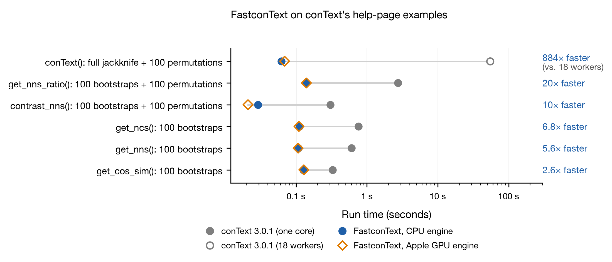

# FastconText

FastconText is a faster implementation of the R package
[conText](https://github.com/prodriguezsosa/conText) (R CRAN version 3.0.1) for embedding regression
and 'a la carte' word embeddings. It keeps the functions and arguments of the original conText package,
so existing code can run without any further changes by importing `library(FastconText)`.

> FastconText is an independent package. It is not affiliated with or endorsed by the authors
> of conText. Please cite their work (see [Citation](#citation)) when you use it.

## Purpose

Embedding regression (Rodriguez, Spirling, and Stewart 2023) examines whether the contextual meaning of a word
differs across groups defined by covariates, such as party or gender, and quantifies the uncertainty of that
difference with a jackknife and a permutation test. In conText, the jackknife drops one context
(an occurrence of the target word) at a time and refits the regression, with one outcome per
embedding dimension D, on the remaining n − 1 contexts. It therefore runs n refits, and each refit becomes
computationally more costly as n grows, so the total run time grows as O(n^2). On corpora of tens of thousands of
contexts, a single model can take hours or days, even on a high-performance computing cluster.

FastconText removes that bottleneck without changing the estimator. Its purpose is to make the
full jackknife and permutation inference of conText practical on a laptop, so that researchers
can report it routinely rather than subsample the documents or skip that step.

## How the speedup works

| Part of conText | conText 3.0.1 | FastconText |
|---|---|---|
| Regression fit (`run_ols`) | `estimatr::lm_robust` on each of the D embedding dimensions | one closed-form weighted least-squares solve for all dimensions at once |
| Jackknife | one full refit per left-out context or cluster | per-cluster summary statistics computed once; each leave-one-out estimate and its cluster-robust standard errors computed from small matrix updates |
| Permutation test | one least-squares solve per permutation | all permutations solved in one batched matrix product |
| `get_nns`, `get_cos_sim`, `get_ncs`, `get_nns_ratio`, `contrast_nns`, `bootstrap_nns` | resample, regroup, and compare with the vocabulary once per draw | all draws collapsed into one sparse averaging matrix; similarities, means, standard deviations, quantiles, and permutation counts computed in one pass |

The closed-form compute engine is written in multi-threaded double-precision C++ and runs on any
platform. On macOS, an optional Apple GPU (Metal) engine handles large similarity and
permutation batches. Note, however, that most of the speedup comes from the closed-form algorithms, so the CPU
engine alone delivers most of the speedup.

## Speedup on the conText example data

The figure compares the run time of conText and FastconText on the example data shipped with conText.
conText's `conText()` help-page example with a full jackknife and 100 permutations takes 54.8 seconds in conText with 18 cores, and 0.06 seconds in FastconText.



Run time in seconds:

| Task | conText (one core) | conText (18 cores) | FastconText (CPU) | FastconText (GPU) | Speedup (CPU) |
|---|---|---|---|---|---|
| `conText()`: full jackknife + 100 permutations | 517.6 | 54.8 | 0.062 | 0.069 | 884× |
| `get_nns_ratio()`: 100 bootstraps + 100 permutations | 2.737 | - | 0.138 | 0.140 | 20× |
| `contrast_nns()`: 100 bootstraps + 100 permutations | 0.304 | - | 0.029 | 0.021 | 10× |
| `get_ncs()`: 100 bootstraps | 0.760 | - | 0.112 | 0.110 | 6.8× |
| `get_nns()`: 100 bootstraps | 0.604 | - | 0.108 | 0.107 | 5.6× |
| `get_cos_sim()`: 100 bootstraps | 0.327 | - | 0.127 | 0.129 | 2.6× |

Benchmarks were run on an Apple M5 Max laptop (18 CPU cores, 40-core GPU, 128GB RAM) with R 4.5.3 and conText 3.0.1.
The scripts are in [`benchmarks/`](benchmarks/).

## Reproducibility

On the same benchmark tasks, the outputs of FastconText are the same as conText.
The table shows the largest absolute difference across all numeric outputs.

| Task | CPU engine | GPU engine |
|---|---|---|
| `conText()`: full jackknife + 100 permutations | 1.3e-13 | 1.8e-13 |
| `get_nns_ratio()`: 100 bootstraps + 100 permutations | 6.7e-16 | 1.2e-06 |
| `contrast_nns()`: 100 bootstraps + 100 permutations | 1.1e-15 | 1.2e-06 |
| `get_ncs()`: 100 bootstraps | 5.6e-16 | 6.0e-07 |
| `get_nns()`: 100 bootstraps | 3.3e-16 | 4.0e-07 |
| `get_cos_sim()`: 100 bootstraps | 1.7e-16 | 4.4e-08 |

Regressions, the jackknife estimator, and the ALC transform are always computed in double precision.
On the GPU, the similarity calculations in the bootstrap and permutation steps use single precision.
Because of the lower precision, these outputs differ slightly more from conText, but
by no more than about 1e-6. The GPU engine uses single precision because Apple GPUs do not natively support float64.

## Installation

```r
# install.packages("remotes")
remotes::install_github("yjin-chae/FastconText")
```

A C++17 compiler is required. On macOS, the Xcode Command Line Tools is required.
On Linux, only the CPU engine is built.

## Usage

```r
library(FastconText)   # instead of library(conText)
library(quanteda)

toks <- tokens(cr_sample_corpus)
set.seed(2021L)
model <- conText(immigration ~ party + gender, data = toks,
                 pre_trained = cr_glove_subset, transform = TRUE,
                 transform_matrix = cr_transform,
                 jackknife = TRUE, permute = TRUE, num_permutations = 100,
                 window = 6, case_insensitive = TRUE, verbose = FALSE)
model@normed_coefficients

metal_info()           # whether an Apple GPU is available to this R session
```

## Options

```r
options(FastconText.backend = "auto")    # "auto" (default), "metal" (force GPU), "cpu", "original"
options(FastconText.jackknife = "auto")  # engine for the jackknife loop: "auto", "metal", "cpu"
options(FastconText.threads = 8)         # CPU threads (default: all physical cores)
options(FastconText.gpu_min_flops = 1e8) # size above which "auto" sends work to the GPU
```

`"original"` runs the original conText 3.0.1 code, which is useful for checking results.

## Citation

FastconText implements methods developed by other researchers. Please cite the original work:

* Rodriguez, P. L., Spirling, A., & Stewart, B. M. (2023). Embedding regression: Models for
  context-specific description and inference. *American Political Science Review, 117*(4),
  1255–1274. https://doi.org/10.1017/S0003055422001228
* Khodak, M., Saunshi, N., Liang, Y., Ma, T., Stewart, B., & Arora, S. (2018). A la carte
  embedding: Cheap but effective induction of semantic feature vectors. *Proceedings of ACL 2018*.
  https://doi.org/10.48550/arXiv.1805.05388
* Green, B., Hobbs, W., Avila, S., Rodriguez, P. L., Spirling, A., & Stewart, B. M. (2025).
  Measuring distances in high dimensional spaces. *Political Analysis, 33*(3), 266–273.
  https://doi.org/10.1017/pan.2024.22
* The conText package: https://github.com/prodriguezsosa/conText

## Code provenance

FastconText is a modified copy of conText 3.0.1, which was developed by Pedro L. Rodriguez,
Arthur Spirling, Brandon Stewart, and Sofia Avila (maintainer), with contributions from
Christopher Barrie.

**Reused without changes:** Most of conText's R code, including tokenization, context
extraction, and the `conText` object classes, as well as its example data and help pages.

**Reused with small changes:** Several conText R files, including `conText.R`, `get_nns.R`, and
`get_cos_sim.R`. Each change adds code that hands over the
computation to the new engine. The original code is kept and still runs with
`options(FastconText.backend = "original")` and in fallback cases.

**Newly written:** The closed-form linear algebra for embedding regression, jackknife and permutation test
(`R/fast_regression.R`), the bootstrap and permutation computations of the similarity functions (`R/fast_bootstrap.R`),
engine selection (`R/backend.R`), the C++ CPU engine and the Apple GPU engine (`src/`), the
build scripts, the tests (`tests/`), and the benchmarks (`benchmarks/`).

## Development note

The code was developed and revised in consultation with Claude Opus 5.5.
All of the code was validated against conText 3.0.1 as described above, and the maintainer is
responsible for its content.
